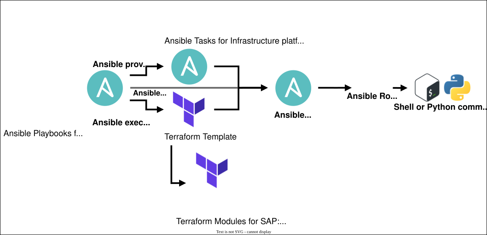

# Provisioning Console

## Description
This repository contains Ansible Playbooks for deployment of various SAP Software solution scenarios onto different Hyperscaler Cloud Service Providers and Hypervisors platforms.


## Benefits of Ansible Playbooks for SAP
The Ansible Playbooks for SAP offer several key benefits:
- **Ease of Use:** The playbooks are designed with simplicity in mind, making them accessible for users with varying levels of Ansible experience.
- **Highly Adaptable:** They are easily reconfigurable and extendable, allowing you to tailor deployments to your specific needs.
   - For example, you can customize them for specific SAP versions, integrate with monitoring tools, or adapt them to different network topologies.
- **Scenario-Specific and Self-Contained:** Each playbook encapsulates a complete deployment scenario, ensuring consistency and reducing complexity.
- **Consistent Across Platforms:** Deploy the same SAP solution across diverse infrastructure platforms (Hyperscaler Cloud Service Providers and Hypervisor platforms) with predictable results.
- **Infrastructure Flexibility:** Choose between Ansible or Terraform for infrastructure provisioning, providing flexibility in your deployment approach.
- **Corporate-Ready:** Licensed for corporate use by SAP Customers, SAP Service Partners, and SAP Technology Partners.


## Supported Configurations
### Supported Operating Systems
- SUSE Linux Enterprise Server for SAP Applications (SLES4SAP)
- Red Hat Enterprise Linux for SAP (RHEL4SAP)

### Supported Infrastructure Platforms
- AWS EC2 Virtual Server instances
- Google Cloud Compute Engine Virtual Machines
- IBM Cloud, Intel Virtual Servers
- IBM Cloud, Power Virtual Servers
- Microsoft Azure Virtual Machines
- IBM PowerVM Virtual Machines (LPARs)
- OVirt (e.g. Red Hat Enterprise Linux KVM)
- KubeVirt (e.g. Red Hat OpenShift Virtualization, SUSE Rancher with Harvester HCI) `[Experimental]`
- VMware vSphere Virtual Machines `[Beta]`
- Apache CloudStack Virtual Machines (KVM, XenServer/XCP-ng, VMware hypervisors) `[Beta]`
- Existing hosts without provisioning

### Supported Deployment Scenarios
| SAP Product | Versions | Deployment Topology | Database |
| --- | --- | --- | --- |
| SAP HANA | 2.0 SPS 08<br> 2.0 SPS 07<br> 2.0 SPS 06 | Sandbox<br> Scale-Out <br> Scale-Up High Availability | SAP HANA |
| SAP BW/4HANA | 2023<br> 2021 | Sandbox<br> Scale-Out | SAP HANA |
| SAP S/4HANA | 2023<br> 2022<br> 2021<br> 2020 | Sandbox<br> Standard<br> Distributed<br> Distributed with High Availability | SAP HANA |
| SAP S/4HANA<br> Maintenance Plan | Any version - Defined by Maintenance Plan</br> Includes latest FPS and security patches | Sandbox<br> Standard<br> Distributed<br> Distributed with High Availability | SAP HANA |
| SAP S/4HANA Foundation | 2023<br> 2022<br> 2021 | Sandbox<br> Standard | SAP HANA |
| SAP Landscape for SAP S/4HANA | 2023<br> 2022<br> 2021<br> 2020 | 3-System Standard | SAP HANA |
| SAP Landscape for SAP S/4HANA<br> Maintenance Plan | Any version - Defined by Maintenance Plan</br> Includes latest FPS and security patches | 3-System Standard | SAP HANA |
| SAP Business Suite (ECC) | EHP 8<br> EHP 7 | Sandbox | SAP HANA |
| SAP Business Suite (ECC) | EHP 8 | Sandbox<br> Distributed (IBM Db2) | IBM Db2<br> Oracle DB<br> SAP ASE<br> SAP MaxDB |
| SAP IDES for ECC | EHP 8 | Sandbox | SAP HANA, IBM Db2 |
| SAP NetWeaver ABAP | 7.52 SP00<br> 7.50 SP00 | Sandbox | SAP HANA<br> IBM Db2<br> Oracle DB<br> SAP ASE<br> SAP MaxDB |
| SAP NetWeaver JAVA | 7.50 SP22 | Sandbox | IBM Db2<br> SAP ASE |
| SAP Solution Manager ABAP/JAVA | 7.2 SR2 | Sandbox | SAP HANA<br> SAP ASE |

> <sub>Note: Additional SAP Product versions can be added by customizing extra vars file.</sub>  

The explanation of Deployment Topologies:
| Deployment Topology | Definition |
| --- | --- |
| Sandbox | A single-host system, that consolidates all SAP Database and SAP ABAP Platform instances onto a single host |
| Standard | A standard system, that consists of the SAP Application running on a dedicated host, and an SAP Database server running on another dedicated host |
| Distributed | A distributed SAP system, that separates the SAP Application components from the database server, placing them on distinct hosts |
| Distributed with High Availability | A distributed SAP system with High Availability (HA), that separates the SAP Application components from the database server, placing them on distinct hosts |
| Scale-Out | An Scale-Out system, that consists of an SAP Application instances running on a dedicated host, and an SAP HANA database server running as a scale-out cluster across multiple hosts. |


### Supported Special Playbooks
- SAP Web Dispatcher, Standalone (with SAP Kernel Part II for SAP HANA)
- SAP SolMan Diagnostics Agent (SDA) `[Experimental]`
- Download SAP Software installation media
- System Copy Export, IBM Db2 `[Experimental]`
- System Copy Restore (SAP ECC on HANA or SAP S/4HANA), Sandbox  `[Experimental]`
- SAP ASCS/ERS Cluster Installation


## How to get started
**Before running the playbook, please read the [full documentation](/docs#readme) for how-to guidance, requirements, and all other details.**  
- Ensure that the password variables are defined following [Prepare the Password Variables](/docs#prepare-the-password-variables).  
- Ensure that the variables with placeholder values are correctly defined. Placeholder value can be recognized as `ENTER_STRING_VALUE_HERE`.

The playbooks can be executed with one of following methods.

### Guided web UI (recommended)
The provisioning console is a web UI that provisions SAP systems with these playbooks without editing variable files.

What it does:
- **Provider connections:** one tab per platform (AWS, Google Cloud, Microsoft Azure, Apache CloudStack) for the
  connection settings and your *Owner tag* (e-mail or user ID). The dashboard shows the VMs of each platform that carry
  your Owner tag and lets you delete them.
- **Wizard:** choose the scenario, platform and host plan, enter the SAP and network inputs, add an optional YAML
  override for any playbook variable, and run the preflight checks. Inputs can be loaded from and saved to a JSON file;
  saved files never contain passwords, secrets or keys. Examples: [sample-inputs/](sample-inputs).
- **Jobs:** live log of the playbook run, the SSH connection details of the provisioned hosts (including an SSH config
  snippet), and *Terminate* to delete the resources of the job.
- **SAP installation media:** either from a directory you provide, or downloaded with your SAP S-user during the run.

#### Run the container image
```bash
mkdir -p container-data media
docker run -d --name sap-wizard -p 127.0.0.1:5000:5000 \
  -e SAP_WIZARD_STATE_DIR=/var/lib/sap-wizard \
  -e SAP_SSH_DIR_HOST=$HOME/.ssh \
  -v $PWD/container-data:/var/lib/sap-wizard \
  -v $HOME/.ssh:/mnt/ssh:ro \
  -v $PWD/media:/mnt/media:ro \
  ghcr.io/ksanjeet/provisioning-console:latest
```
Then open http://localhost:5000.

#### Build and run with Docker Compose
Requires Docker with Compose v2 and BuildKit:
```bash
git clone -b feature/cloudstack-console https://github.com/ksanjeet/provisioning-console.git
cd provisioning-console
docker compose up --build
```
The build fetches the `community.sap_infrastructure` collection with the Apache CloudStack platform from its GitHub
fork branch. Settings can be placed in a `.env` file next to [compose.yml](compose.yml):

| Variable | Default | Purpose |
|---|---|---|
| `SAP_WIZARD_PUBLISH_ADDRESS` | `127.0.0.1` | Address the console is published on; `0.0.0.0` to reach it from other machines (enable authentication then) |
| `SAP_WIZARD_PUBLISH_PORT` | `5000` | Published port |
| `SAP_WIZARD_AUTH_USER`, `SAP_WIZARD_AUTH_PASSWORD` | empty | HTTP basic authentication for the console |
| `SAP_SSH_DIR` | `./ssh` | Host directory with SSH keys, mounted read-only to `/mnt/ssh` |
| `SAP_MEDIA_DIR` | `./media` | Host directory with SAP installation media, mounted read-only to `/mnt/media` |
| `FLASK_SECRET_KEY` | generated | Session key; generated once and stored in the state directory when empty |
| `SAP_INFRASTRUCTURE_DIR` | GitHub fork branch | Build context of the `community.sap_infrastructure` collection, e.g. a local checkout for development |

#### Run without a container
Requires Python 3.11, Ansible, the collections of [container/ansible-requirements.yml](container/ansible-requirements.yml) and
`community.sap_infrastructure` from the fork branch (see [deploy_scenarios/sap_hana_ha/ansible_requirements.yml](deploy_scenarios/sap_hana_ha/ansible_requirements.yml)):
```bash
python3.11 -m venv .venv
source .venv/bin/activate
pip install -r requirements.txt
python app.py
```

#### First steps
1. Open the provider card of your platform, use *Configure provider* and fill in its tab, including the *Owner tag*.
2. Run the wizard, or load a wizard input file and add the secrets, which are never stored in these files.
3. Follow the job. When it has finished, the job page shows how to connect to the hosts and offers *Terminate*.

#### SSH keys and SAP media
- Enter paths as seen by the console: in the container `/mnt/ssh/<key>` for SSH keys. Paths under the host SSH directory
  (`SAP_SSH_DIR_HOST`) are translated to `/mnt/ssh` automatically.
- Media you already have: mount the directory to `/mnt/media` and enter `/mnt/media` as installation media directory.
- Media download with the S-user: the files are downloaded to the state directory (`container-data/sap_media`) and reused
  by later jobs, so keep the same state directory between container runs. The installation media directory field must
  still point to an existing directory in the console, e.g. the (empty) `/mnt/media` mount.

#### Security
- The console is a single-user tool. Saved provider profiles (cloud credentials) and generated variables (SAP
  passwords) are stored in plaintext in the state directory (`container-data`, `/var/lib/sap-wizard` in the
  container). Keep it private; do not share it or bake it into images.
- It listens on `127.0.0.1` by default. When publishing it on the network, set `SAP_WIZARD_AUTH_USER` and
  `SAP_WIZARD_AUTH_PASSWORD`, or reach it through an SSH tunnel.

#### Resource ownership and teardown
- VMs are tagged `Owner=<your Owner tag>` (on Google Cloud as label `owner`, e.g. `user_name-at-example_com`). The
  inventory lists and allows deleting only VMs with your Owner tag; without an Owner tag it is read-only.
- Resources created with the VMs carry the Owner tag as well where the platform allows it: AWS EBS volumes, network
  interfaces and placement groups; MS Azure OS and data disks, SBD shared disks, network interfaces, load balancers and
  availability sets; Google Cloud data disks; Apache CloudStack root and data volumes. Not taggable by the automation:
  Google Cloud boot disks, static IP addresses, forwarding rules, health checks, backend services and instance groups,
  AWS route table entries, AWS IAM roles shared by all HA deployments of an account, CloudStack affinity groups and
  LINSTOR SBD resources.
- HA load balancers (`lb-<sid>-<primary host>-hana|anydb|nwas`) and placement groups / availability sets / placement
  policies (`pg-<sid>-<primary host>-spread`) get unique names per deployment, so several deployments can share an
  account, project or subscription. Set the playbook variables (e.g. `sap_vm_provision_ha_load_balancer_name_hana`) in
  the YAML override to choose your own names.
- *Terminate* deletes only resources of the job: its VMs (by host name, created by the automation), their disks and
  network interfaces, and HA resources with the job's unique names. Shared HA resources (MS Azure load balancers,
  availability sets, SBD disks) are deleted only with the job's Owner tag; load balancers with the role default names
  (`lb-sap-ha-*`) are never deleted. If the VMs were deleted outside the console, leftover disks and network
  interfaces named after the job's hosts are deleted only when they carry the job's Owner tag.

#### Platform notes
- **Apache CloudStack:** prepare the zone once as described in [tools/cloudstack/README.md](tools/cloudstack/README.md)
  (template, KVM CPU model, offerings, fencing). Only credentials entered in the UI, or `CLOUDSTACK_*` environment
  variables passed to the container, are used.
- **AWS HA:** the scenarios create or update the IAM role `HA-Role-Pacemaker`, its policies and the instance profile
  `HA-Instance-Profile-Pacemaker-Cluster`, which requires IAM permissions (not available e.g. with the
  *PowerUserAccess* permission set). Without them, let an administrator create the role and instance profile once and
  add `sap_vm_provision_aws_ha_iam_manage: false` to the YAML override; `iam:PassRole` on the role is still required.

#### Development notes
- [Dockerfile](Dockerfile) pins the Python dependencies of [requirements-container.txt](requirements-container.txt);
  [container/ansible-requirements.yml](container/ansible-requirements.yml) pins the Ansible collections.
- [container/apply_collection_patches.py](container/apply_collection_patches.py) applies compatibility fixes to the
  installed collections at build time (AWS session token, storage size normalization, SAP HANA System Replication
  commands and log mode). The console checks at startup that the patches are present.
- After changing the patch helper or the collection, rebuild and recreate the service:
  `docker compose up -d --build --force-recreate sap-wizard`.
- The collection source is bind-mounted during the build and not stored in image layers.

### Ansible with existing host(s)
This method is used to install the SAP system on an existing host(s).  
- **Interactive Prompts:** Yes :white_check_mark:
- **Provisioning:** No :x:
- **SAP Installation:** Yes :white_check_mark:
- **Required Variables:**
   - `sap_vm_provision_iac_type: ansible`
   - `sap_vm_provision_iac_platform: existing_hosts`
- **Host definition:** The existing hosts are defined using:
   - Ansible inventory file (e.g. `optional/ansible_inventory_noninteractive.yml`).
   - The `sap_vm_provision_existing_hosts_host_specifications_dictionary` variable defined in `optional/ansible_extravars_existing_hosts.yml` file.

#### Prerequisites for existing host(s)
Control Node:
- The `.ssh/known_hosts` file on the Ansible Control Node (under the execution user's home directory) must contain entries for the existing hosts.
  - Ensure `ssh-keyscan` has been executed for the IP address or alias that corresponds to the host parameter defined in your Ansible inventory file. This ensures the control node can securely identify the managed hosts.

Managed Nodes (existing hosts):
- The firewall on the managed node must allow incoming SSH communication (typically TCP port 22) from the Ansible Control Node.
- The `/root/.ssh/authorized_keys` file must be correctly configured to allow SSH access from the Ansible Control Node.
   - The public SSH key from the Ansible Control Node must be added to the `/root/.ssh/authorized_keys` file on the managed node.
- The `/etc/hosts` file must contain host's fully qualified domain hostname to determine `ansible_domain`, or set through `sap_domain` variable.
- The `/etc/hosts` file must contain Virtual IP address for High Availability scenarios for SWPM execution (`sap_swpm` role).


### Ansible provisions host(s)
This method provisions a new host(s) and installs the SAP system. 
- **Interactive Prompts:** Yes :white_check_mark:
- **Provisioning:** Yes :white_check_mark:
- **SAP Installation:** Yes :white_check_mark:
- **Required Variables:**
   - `sap_vm_provision_iac_type: ansible`
   - `sap_vm_provision_iac_platform` for your selected Infrastructure Platform (e.g. `aws_ec2_vs` for AWS).
- **Host definition:** The provisioned hosts are defined using:
   - `host_specifications_dictionary` variable defined in extra vars file.
   - Example for AWS: `sap_vm_provision_aws_ec2_vs_host_specifications_dictionary` variable in `ansible_extravars_aws_ec2_vs.yml` file.


### Ansible uses Terraform to provision minimal landing zone and host(s)
This method provisions a minimal landing zone and a new host(s) using Terraform and installs the SAP system using Ansible. 
- **Interactive Prompts:** Yes :white_check_mark: `[Experimental]` (Limited support for Terraform variables)
- **Provisioning:** Yes :white_check_mark:
- **SAP Installation:** Yes :white_check_mark:
- **Required Variables:**
   - `sap_vm_provision_iac_type: ansible_to_terraform`
   - `sap_vm_provision_iac_platform` for your selected Infrastructure Platform (e.g. `aws_ec2_vs` for AWS).
- **Host definition:** The provisioned hosts are defined using:
   - The `host_specifications_dictionary` variable defined in extra vars file.
   - Example for AWS: `sap_vm_provision_aws_ec2_vs_host_specifications_dictionary` variable in `ansible_extravars_aws_ec2_vs.yml` file.
> <sub>Note: Ansible Playbooks for SAP optionally use Ansible > Terraform. To instead use Terraform > Ansible, see [Terraform Templates for SAP](https://github.com/sap-linuxlab/terraform.templates_for_sap)</sub>


## Interactive Prompts
Interactive prompts are available for most of the deployment playbooks.  

Exceptions include: S4/HANA Landscape and Solution Manager.

This mode is recommended if you need help entering all required variables in extra vars files.
- It will prompt for all undefined variables.
- It will validate all defined variables and those obtained from prompts.

How to execute Interactive Prompts mode:
1.  **Prepare the `optional/ansible_extravars_interactive.yml` file:** This file contains the essential set of variables for initiating Interactive Prompts.
2.  **Execute the playbook:** Run the following command `ansible-playbook ansible_playbook.yml --extra-vars "@./optional/ansible_extravars_interactive.yml"`


## Workflow diagram of playbook execution



## Disclaimer
These Ansible Playbooks for SAP provide Infrastructure-as-Code (IaC) and Configuration-as-Code (CaC) automation for common SAP software solution scenarios. They offer a codified approach to streamline and standardize deployments, which can be extended to meet specific requirements.  

These playbooks are not intended to replicate every possible SAP software deployment scenario, nor do they replace existing SAP installation procedures detailed in the [SAP Help Portal](https://help.sap.com) or [SAP Notes on SAP ONE Support](https://launchpad.support.sap.com). While the Ansible Role for SAP SWPM enables the installation of any SAP software supported by SAP Software Provisioning Manager (SWPM 1.0/2.0), always refer to official SAP documentation for the most accurate and up-to-date guidance.  

These playbooks are valuable for accelerating tasks such as rapid provisioning and testing (e.g., evaluating the latest software releases, applying patches, or performing system copy restores in cloud environments). They can be adapted to suit these needs.  

For comprehensive lifecycle management of SAP systems, consider [SAP Landscape Management Enterprise Edition](https://www.sap.com/uk/products/landscape-management.html).  

For evaluating SAP software business functionality, [SAP Cloud Appliance Library](https://www.sap.com/products/cloud-appliance-library.html) offers a convenient platform.

### Pseudo-Idempotency
Idempotency ensures that applying the playbook multiple times results in the same system state as applying it once.  
While these playbooks strive for idempotency, certain limitations exist.

Potential issues:
1. **NFS Mounts:**
   - The playbooks mount NFS shares but do not currently validate or purge existing mounts.
   - Re-running the playbook without cleaning up previous NFS mounts may lead to SAP Software Provisioning Manager (SWPM) failures or unexpected behavior due to the presence of existing SAP directories.
2. **SAP System Detection:**
   - The `sap_swpm` Ansible role, used for SAP software installation, may fail or produce inconsistent results if it detects an existing SAP system on the target host.
   - To avoid issues, use the playbooks on fresh systems or ensure thorough cleanup of any previous SAP installations.


## License
[Apache 2.0](./LICENSE)

## Contributors
Key contributors are shown within the [contributors](./docs/CONTRIBUTORS.md) file.

## Contributing
You can find more information about ways you can contribute at [How to contribute](./docs/CONTRIBUTING.md).
